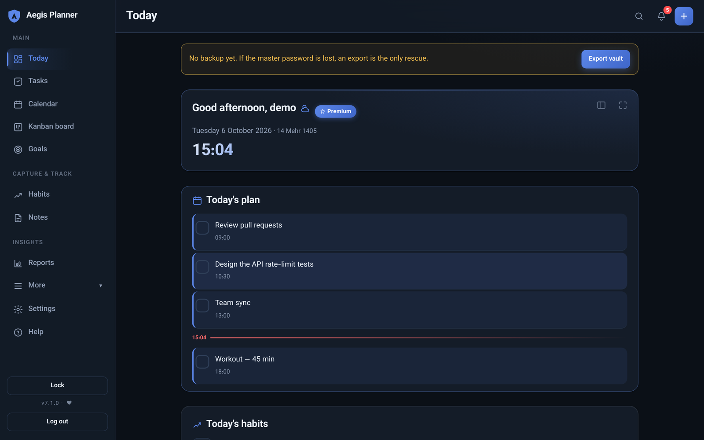

<div dir="rtl" align="right">

# Aegis Planner — برنامه‌ریز زیرو-نالج

**دفترچه‌ای که فقط خودت بازش می‌کنی.** تسک‌ها، یادداشت‌ها و تقویم تو در مرورگر خودت رمز می‌شوند؛ سرور فقط داده‌ی رمزشده را نگه می‌دارد و راهی برای خواندنش ندارد.

[English README](README.md)



## ویژگی‌ها

- **تسک‌ها:** اولویت، دسته، برچسب، زیرتسک، تکرار، ساعت شروع/پایان، قالب و سطل زباله
- **تقویم:** ماه/هفته/۳ روزه/روز/برنامه، **شمسی و میلادی**، درگ‌اندراپ، خروجی iCal
- **کانبان، اهداف، عادت‌ها، یادداشت‌ها، پومودورو و گزارش‌ها** (همه محلی روی ولت رمزگشایی‌شده)
- **PWA و آفلاین:** قابل نصب، کش آفلاین، یادآور Web Push (اختیاری)
- **دوزبانه** (فارسی/انگلیسی) با RTL کامل، تم، موبایل‌محور
- **بخش مدیریت:** کد دعوت، تأیید دستی کاربران، پنل ادمین

## مدل امنیتی

`مستر پسورد ← PBKDF2-SHA256 (۶۰۰٬۰۰۰ تکرار) ← KEK ← بازکردن DEK ← AES-256-GCM روی ولت`

- مستر پسورد و کلیدها هرگز به سرور نمی‌روند؛ DEK فقط در حافظه‌ی مرورگر است و با قفل/رفرش/۱۵ دقیقه بی‌فعالیتی پاک می‌شود.
- تغییر مستر پسورد فقط DEK را دوباره بسته‌بندی می‌کند.
- کلید بازیابی اختیاری و اکسپورت رمزشده برای حالت فراموشی رمز.
- Argon2، CSP سخت‌گیرانه (بدون inline و eval)، CSRF، کوکی امن، ریت‌لیمیت و قفل حساب.
- گم‌شدن مستر پسورد بدون کلید بازیابی یا اکسپورت یعنی از دست رفتن داده — این عمدی است.

جزئیات کامل: [`docs/fa/security-design.fa.md`](docs/fa/security-design.fa.md)

## اجرای محلی

</div>

```bash
git clone https://github.com/sepehrkhasto/aegis-zk-planner.git
cd aegis-zk-planner
python -m venv .venv && source .venv/bin/activate     # ویندوز: .venv\Scripts\activate
pip install -r requirements.txt
cp .env.example .env                                   # برای توسعه: DJANGO_DEBUG=True
python manage.py migrate
python manage.py createcachetable
python manage.py createsuperuser
python manage.py runserver
```

<div dir="rtl" align="right">

سپس در `/admin/` یک کد دعوت بساز، در `/accounts/register/` ثبت‌نام کن، تأیید شو و مستر پسورد را بساز.

راهنمای ویندوز و دیپلوی: پوشه‌ی [`docs/fa/`](docs/fa/)

## تست‌ها

</div>

```bash
python manage.py test      # ۱۴۶ تست جنگو
node tests/js/run.js       # ۵۵۶ تست جاوااسکریپت
```

<div dir="rtl" align="right">

## لایسنس

[MIT](LICENSE) © ۲۰۲۶ سپهر خستو

</div>
