<div align="center">


# Aegis Planner

**A zero-knowledge personal planner. Your tasks, notes and calendar are encrypted in your browser — the server only ever stores ciphertext.**

[](https://github.com/sepehrkhasto/aegis-zk-planner/actions/workflows/ci.yml)


[فارسی](README.fa.md) · [Features](#features) · [Security model](#security-model) · [Quick start](#quick-start) · [Architecture](#architecture) · [Tests](#testing)


</div>

---

## Why this exists

Most planners keep your plans in plaintext on someone else's server. Aegis Planner is built around one rule:
**what the server cannot read, it cannot leak.** Everything you write is encrypted on your device with a key derived
from a master password that is never sent anywhere. The backend is a deliberately "blind" store: it handles
accounts, access control and encrypted blobs — nothing more.

It is also a full-featured planner, not a crypto demo: calendar, kanban, goals, habits, notes, reports, offline support
and an installable PWA, in English and Persian (with a Jalali/Gregorian calendar).

## Features

| Area | What you get |
|---|---|
| **Tasks** | Priorities, categories, tags, sub-tasks, repeat rules, due dates and time ranges, templates, search, trash with restore |
| **Calendar** | Month / week / 3-day / day / schedule views, drag-and-drop and resize, **Jalali and Gregorian** calendars, iCal export, print |
| **Kanban** | To do → Doing → Done board with drag-and-drop (and an explicit move button on mobile) |
| **Goals** | Deadlines with linked tasks and live progress |
| **Habits** | Weekly targets, streaks, heat-map history |
| **Notes** | Rich-text notes with pinning, search and Markdown export |
| **Focus** | Built-in Pomodoro timer |
| **Reports** | Completion, workload and habit insights computed **locally** from the decrypted vault |
| **Productivity** | Command palette (<kbd>Ctrl</kbd>/<kbd>⌘</kbd>+<kbd>K</kbd>), keyboard shortcuts, weekly review, notifications |
| **PWA & offline** | Installable, service worker, offline cache with queued writes, optional Web Push reminders |
| **i18n & a11y** | English/Persian with full RTL, themes, font and density settings, mobile-first layouts |
| **Operations** | Admin panel, invite codes, manual approval gate, subscription/premium handling, broadcasts, feedback inbox, encrypted database backups |

<details>
<summary><b>More screenshots</b></summary>

| | |
|---|---|
| 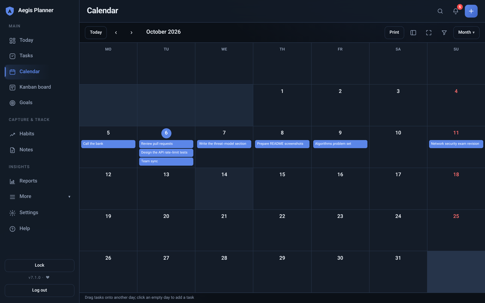 | 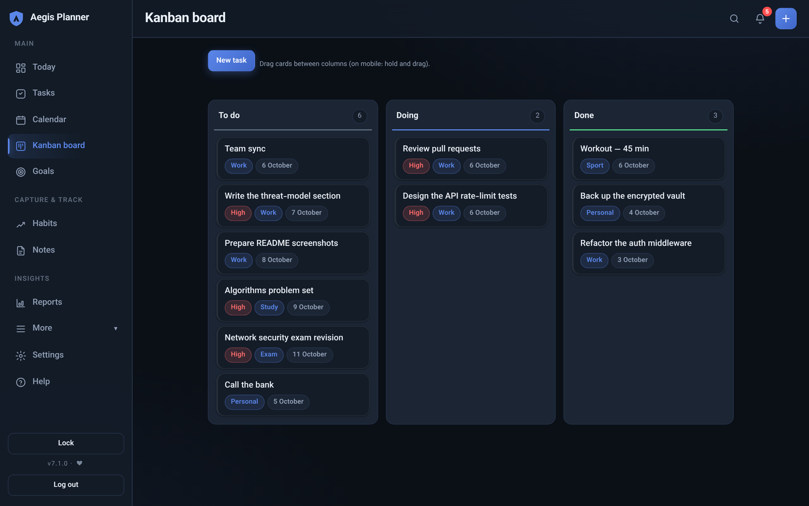 |
| 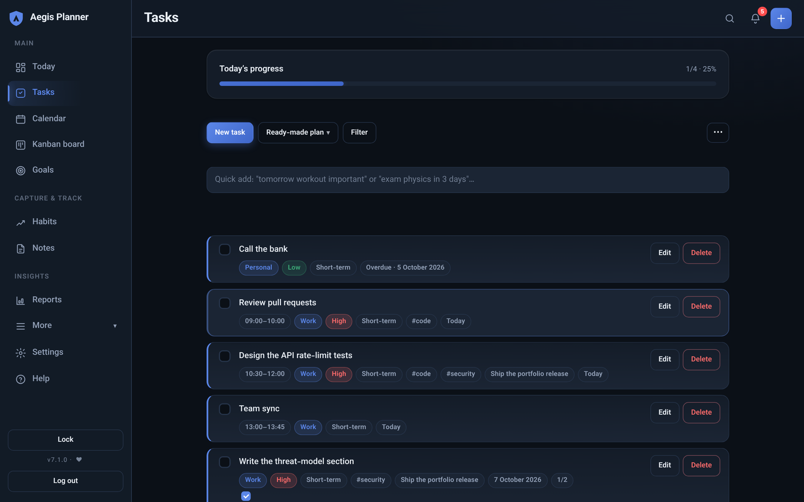 | 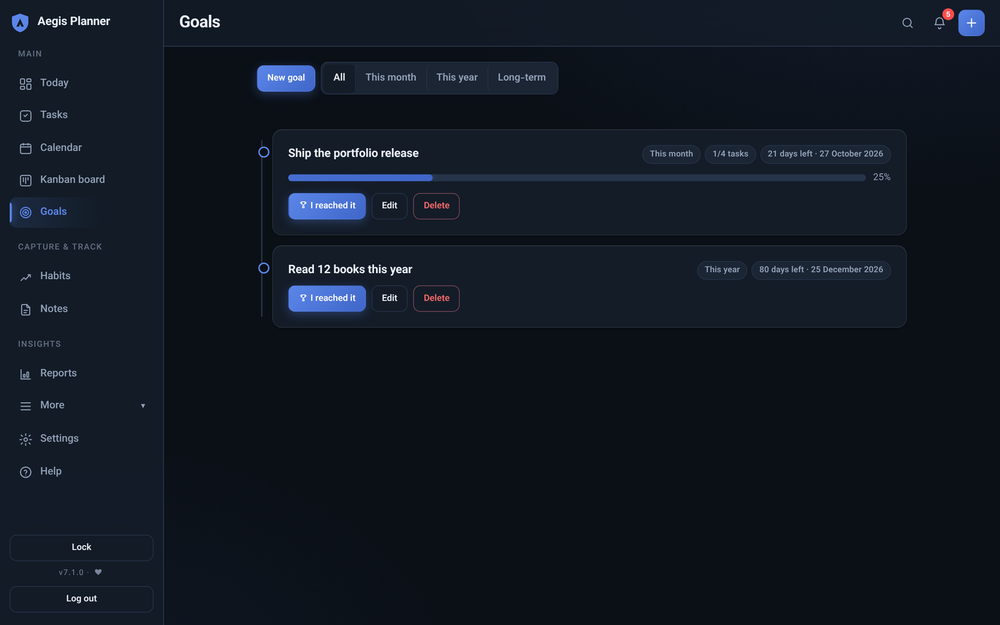 |
| 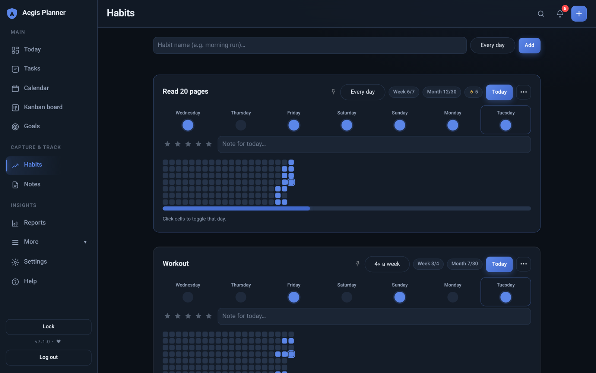 | 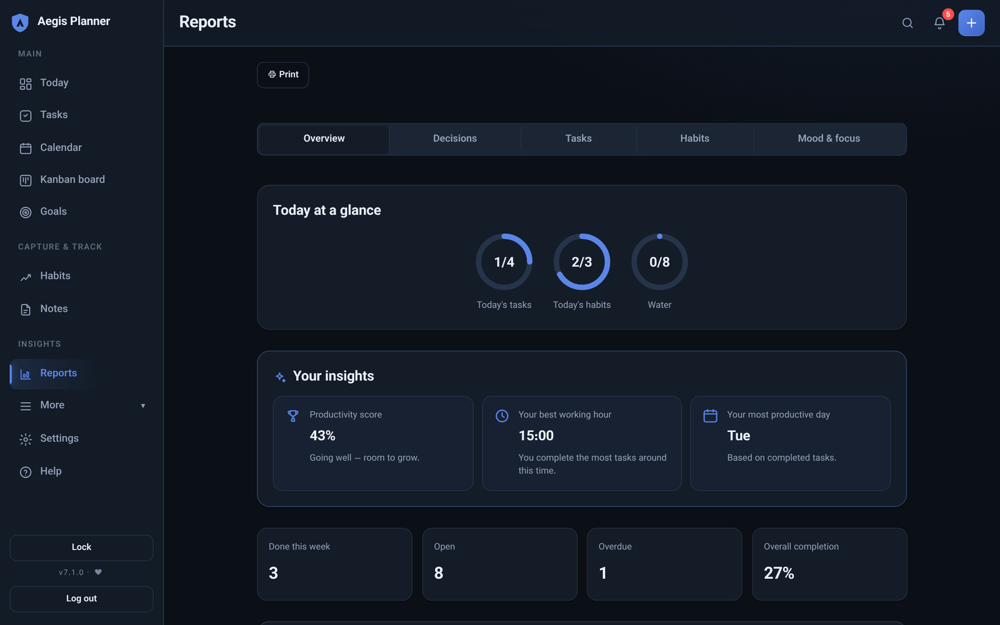 |

**Landing page and mobile**

| | | |
|---|---|---|
| 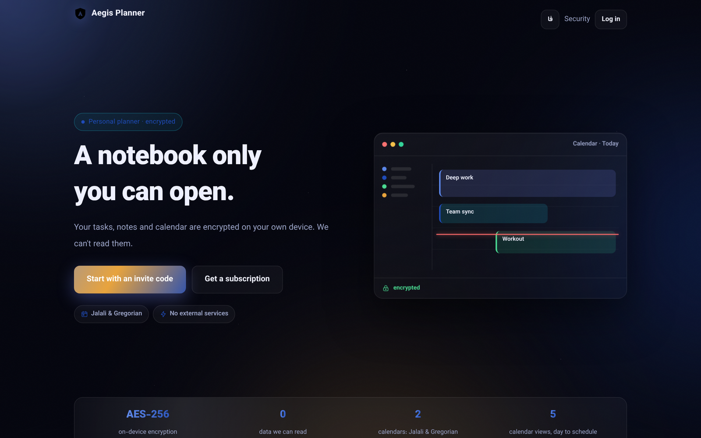 | 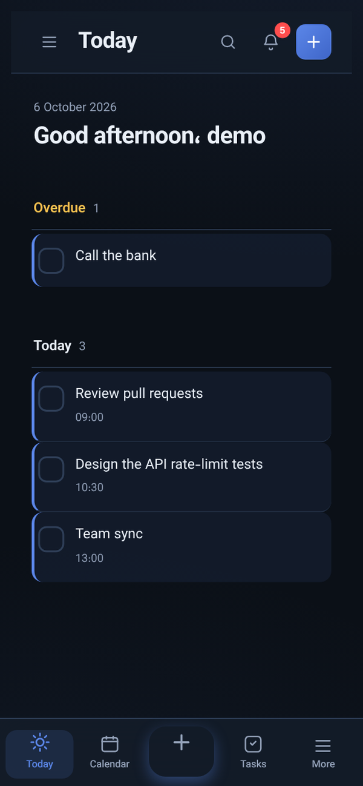 | 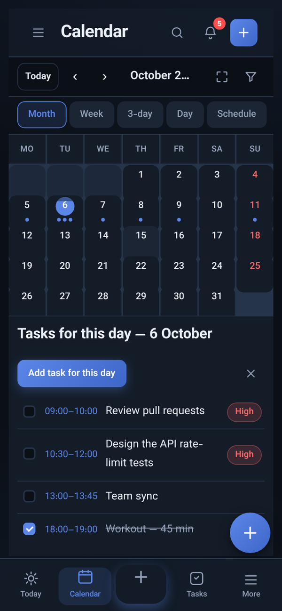 |

</details>

## Security model

Aegis follows the same key hierarchy as modern password managers.

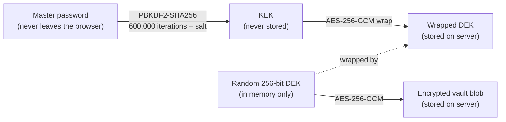

- **Client-side encryption.** The vault is encrypted with AES-256-GCM using the browser's WebCrypto API. The server stores
  only `salt`, `iterations`, the wrapped key and the ciphertext.
- **Cheap password changes.** Changing the master password re-wraps the DEK only; the vault is not re-encrypted.
- **Wrong password = failed authentication.** Verification happens by trying to unwrap the key (GCM tag check), so the
  password is never compared on the server.
- **Recovery.** An optional printed recovery key can reset a forgotten master password. Without it (or an encrypted export),
  a lost master password means lost data — by design.
- **Quick unlock.** A device PIN plus a random on-device pepper can re-open an already-unlocked vault on the same device;
  it never replaces the master password.
- **Auto-lock.** The key lives only in memory and is wiped on lock, refresh or after 15 minutes of inactivity.
- **Safe concurrent writes.** The save API uses optimistic locking (revision numbers), so two devices cannot silently
  overwrite each other.

**Application hardening (server side)**

- Argon2 password hashing, strong password validation (12+ characters)
- Strict Content-Security-Policy: `default-src 'self'`, **no inline scripts, no `eval`**, `frame-ancestors 'none'`
- Secure/HttpOnly/SameSite cookies, CSRF protection, HSTS + SSL redirect in production, `nosniff`, referrer policy
- Per-IP rate limiting on registration/login and per-username lockout after repeated failures
- Invite codes and an admin-approval gate against spam registrations
- Secrets and `DEBUG` only from the environment; the app refuses to start in production with the placeholder key
- All `/api/*` vault endpoints are login-required, CSRF-protected and validate their input

**What this does not protect against:** a compromised device or browser, a malicious browser extension, or someone who
learns your master password. See [`SECURITY.md`](SECURITY.md) for reporting issues and
[`docs/fa/security-design.fa.md`](docs/fa/security-design.fa.md) for the full (Persian) design notes.

## Architecture

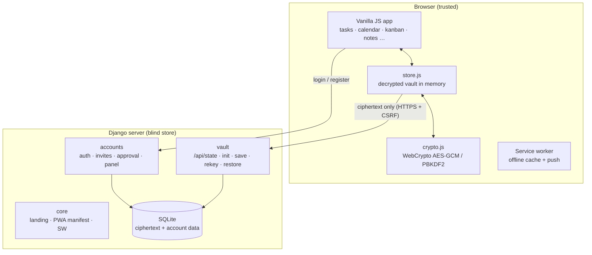

| Path | Responsibility |
|---|---|
| `vault/` | Encrypted-vault API (init, save with revision locking, rekey, recovery, restore), Web Push |
| `accounts/` | Custom user model, invite codes, approval gate, rate limit/lockout, admin panel, backups |
| `core/` | Landing/about pages, PWA manifest and service worker, static-asset safeguards |
| `config/` | Settings (env-driven), URLs, WSGI/ASGI |
| `static/js/` | Framework-free front end; `crypto.js` and `store.js` are the zero-knowledge core |
| `tests/js/` | Node test runner for crypto, Jalali calendar and UI logic |

**Stack:** Django 4.2 LTS · SQLite · vanilla JavaScript (no framework, no bundler) · WebCrypto · Argon2 · django-csp ·
django-ratelimit · WhiteNoise · Gunicorn.

## Quick start

Requires Python 3.10+. WebCrypto needs a secure context, so use `localhost` or HTTPS.

```bash
git clone https://github.com/sepehrkhasto/aegis-zk-planner.git
cd aegis-zk-planner

python -m venv .venv
source .venv/bin/activate          # Windows: .venv\Scripts\activate
pip install -r requirements.txt

cp .env.example .env               # then edit it
# for local development set:  DJANGO_DEBUG=True
# generate a key:  python -c "import secrets; print(secrets.token_urlsafe(64))"

python manage.py migrate
python manage.py createcachetable  # table used by rate limiting / lockout
python manage.py createsuperuser
python manage.py runserver
```

Then:

1. Open `/admin/` and sign in with your superuser.
2. Create an **invite code** (or approve users directly).
3. Register at `/accounts/register/`, get approved, log in and **create your master password** — that is the moment your
   vault key is generated in the browser.

### Configuration

| Variable | Purpose |
|---|---|
| `DJANGO_SECRET_KEY` | **Required** when `DJANGO_DEBUG=False` |
| `DJANGO_DEBUG` | `True` for local development only |
| `DJANGO_ALLOWED_HOSTS` | Comma-separated hostnames |
| `DJANGO_CSRF_TRUSTED_ORIGINS` | Origins with scheme, e.g. `https://planner.example.com` |
| `DJANGO_DB_DIR` | Directory for the SQLite file (point at a persistent volume in production) |
| `VAPID_PUBLIC_KEY` / `VAPID_PRIVATE_KEY` / `VAPID_SUBJECT` | Optional Web Push (generate with `python manage.py gen_vapid_keys`) |
| `PURCHASE_TELEGRAM` | Optional support handle for the subscription page. Leave unset to hide the Telegram card |
| `SEO_ALLOW_INDEX` | Set to `1` to let the public landing page be indexed (everything else stays `noindex`) |

### Production

```bash
DJANGO_DEBUG=False python manage.py collectstatic --noinput
gunicorn config.wsgi
```

Static files are served by WhiteNoise (with Brotli). Deployment guides for PythonAnywhere and Runflare are in
[`docs/fa/`](docs/fa/) (Persian).

## Testing

```bash
python manage.py test      # 146 Django tests: auth, lockout, invites, vault API, panel, backups, push
node tests/js/run.js       # 556 JS checks: crypto, Jalali calendar, i18n parity, UI logic
```

Both suites run on every push via [GitHub Actions](.github/workflows/ci.yml).

## Project notes

- The front end intentionally uses no framework or bundler — the strict CSP forbids inline script and `eval`, so every
  script is a static file.
- Full release history (in Persian) is kept in [`docs/fa/CHANGELOG.fa.md`](docs/fa/CHANGELOG.fa.md).
- The design tokens and brand rules are documented in [`docs/fa/design-system.fa.md`](docs/fa/design-system.fa.md).

## License

[MIT](LICENSE) © 2026 Sepehr Khasto
